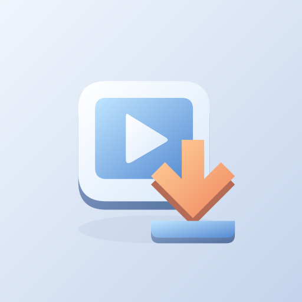
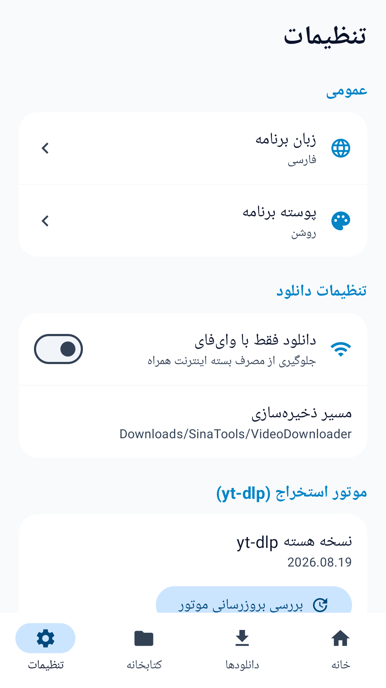
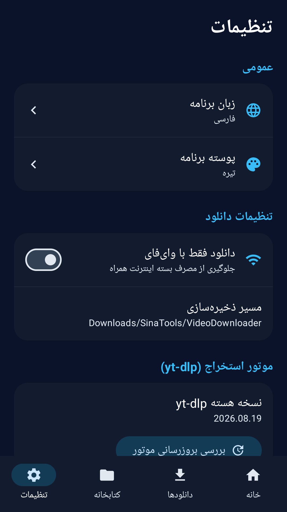
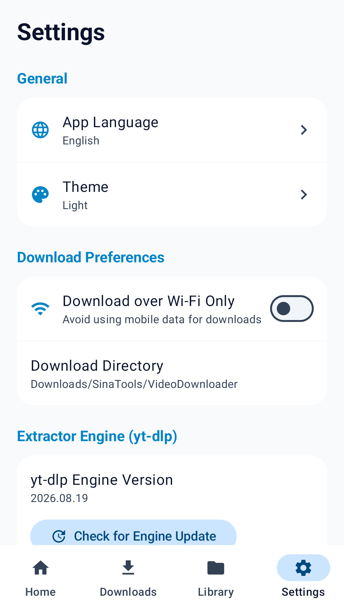
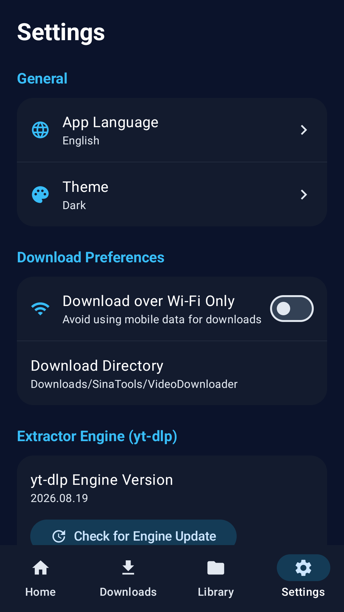

# Video Downloader | دانلودر ویدیو

[Download / دریافت APK](https://github.com/cinaasadpour-hash/video-downloader/releases/tag/v1.0.5)

Package: `com.sinatools.videodownloader` · Version: **1.0.5** · Version code: **6**

## فارسی

دانلود ویدیو و صوت از لینک‌های مستقیم و سایت‌های پشتیبانی‌شده.

لینک ویدیو یا صوت را وارد کنید، قالب و کیفیت در دسترس را انتخاب کنید و فایل را ذخیره کنید. لینک‌های مستقیم، جریان‌های HLS و استخراج رسانه از سایت‌های پشتیبانی‌شده در دسترس‌اند. فایل‌های تکمیل‌شده در کتابخانه قابل پخش و اشتراک‌گذاری هستند.

رابط فارسی و انگلیسی، انتخاب زبان گوشی، حالت روشن، تاریک یا مطابق سیستم و تنظیم دانلود فقط با وای‌فای در برنامه قرار دارند. انتخاب زبان و پوسته پس از بستن برنامه حفظ می‌شود.

امکان دانلود و کیفیت‌ها به سایت مبدأ، شبکه، دسترسی حساب و تغییرات سایت وابسته‌اند؛ پشتیبانی همهٔ لینک‌ها تضمین نمی‌شود. تنها محتوایی را دریافت کنید که اجازهٔ دریافت و استفاده از آن را دارید.

## English

Download video and audio from direct links and supported websites.

Paste a video or audio link, select an available format and quality, and save the media. Direct links, HLS streams and extraction from supported websites are available. Completed files can be played and shared from Library.

Persian and English interfaces, device-language selection, light, dark and system themes, and Wi-Fi-only downloading are available. Language and theme choices persist after closing the app.

Available formats and successful downloads depend on the source website, network, account access and website changes. Support for every link is not guaranteed. Download only content you have permission to obtain and use.

## Privacy / حریم خصوصی

See [Privacy / حریم خصوصی](PRIVACY.md). Store listing text in both languages is available in [store-listing](store-listing).

## Verification / بررسی

The signed APK was installed and launched on a Samsung Galaxy A32 with Android 13 on 2026-10-30, with existing app data preserved. The installed APK checksum matched the release file. Production Tapsell identifiers and the release certificate were checked in the APK. Detailed visual and functional coverage varies by app; this is not a guarantee of compatibility with every device or external service.

نسخهٔ امضاشده در ۳۰ اکتبر ۲۰۲۶ روی گوشی نصب و اجرا شد و اطلاعات قبلی حفظ شد. اثرانگشت نسخهٔ نصب‌شده با فایل انتشار برابر بود. نام بسته، امضا و شناسه‌های واقعی تپسل در APK بررسی شدند. محدودهٔ آزمون هر برنامه متفاوت است و سازگاری با همهٔ دستگاه‌ها و خدمات تضمین نمی‌شود.

Components: [youtubedl-android](https://github.com/yausername/youtubedl-android), [yt-dlp](https://github.com/yt-dlp/yt-dlp), [FFmpeg](https://ffmpeg.org/). Component licenses remain applicable.

## تصاویر برنامه

## Screenshots

